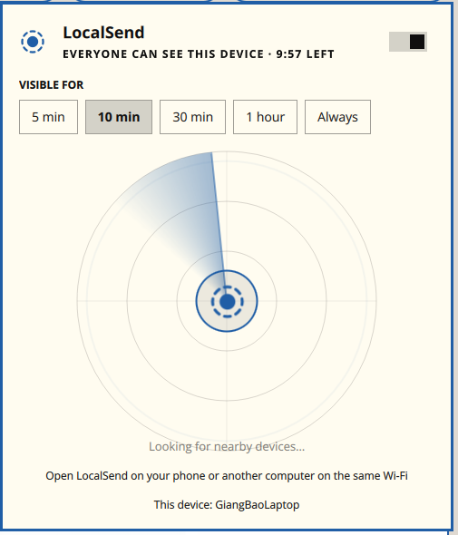

# LocalSend for Omarchy

An AirDrop-style [LocalSend](https://localsend.org) widget for the [Omarchy](https://omarchy.org) bar: a radar of nearby devices, a receive window that closes on its own, and file / folder / clipboard sharing — without opening the LocalSend app.

[Tiếng Việt bên dưới ↓](#tiếng-việt)



## Features

- **Radar** of nearby LocalSend devices (phones, laptops, desktops), found over multicast on your Wi‑Fi/LAN.
- **Visible for 5 min / 10 min / 30 min / 1 hour / Always**, like AirDrop's "Everyone for 10 minutes". Outside the window this computer stays hidden and refuses uploads, but you can still find and send to others.
- **Accept / Decline** card and desktop notification for incoming files. Files are saved to your Downloads folder.
- **Send files, a folder, or the clipboard text** to a device by clicking it on the radar.
- Incoming text messages are copied to the clipboard.
- Progress bar, cancel, and a list of recently received files.
- English and Vietnamese UI (follows the system locale, or pick one in the widget settings).
- Bar icon follows your theme. Left click opens the panel, right click toggles visibility.

## Requirements

- Omarchy 4.0+
- `python3` and `openssl` (both present on a stock Omarchy install)
- TCP and UDP port **53317** open. Omarchy's default firewall already allows it for LocalSend.
- The other device runs the LocalSend app on the same network.

Close the LocalSend desktop app before using this widget: both listen on port 53317.

## Install

```bash
omarchy plugin add https://github.com/ngiangbao/localsend_v2_omarchy_plugin.git --enable
```

## Settings

Set these in the widget settings, or with `omarchy bar set ngiangbao.localsend <key> <value>`:

| Key | Default | Meaning |
|---|---|---|
| `windowMinutes` | `10` | Initial "visible for" choice; `0` means until turned off |
| `deviceName` | hostname | The name other devices see |
| `language` | `Auto` | `Auto`, `English` or `Tiếng Việt` |
| `autoUpdate` | `true` | Update the widget on its own (see below) |

Keyboard (panel open): `v` toggle visibility, `f` send files, `d` send folder, `c` send clipboard.

IPC: `omarchy-shell ngiangbao.localsend open|close|toggle|receive|stop|status`

## How it works

`bin/lsd.py` is a small LocalSend protocol v2.2 peer written in Python with only the standard library. It announces itself on `224.0.0.167:53317`, serves HTTPS on port 53317 with a self-signed certificate kept in `~/.local/share/ngiangbao-localsend/`, and implements `/register`, `/prepare-upload`, `/upload`, `/cancel` and `/info`. The QML widget runs it as a child process and talks to it in JSON lines over stdin and stdout.

Like LocalSend 1.18, it sends a SHA-256 and the file times with every file, presents its certificate to receivers (mutual TLS), and answers a checksum mismatch with `422` so the sender can retry.

Received file names are sanitised, nothing is written outside the Downloads folder, and existing files are never overwritten.

## Staying up to date

- **Upstream watch.** A daily GitHub Actions job (`.github/workflows/upstream.yml`) looks at the latest [LocalSend release](https://github.com/localsend/localsend/releases) and the [protocol spec](https://github.com/localsend/protocol). When either changes, it builds that release's `localsend-cli` and runs `tests/interop.py`: files, folders, text and checksum retries in both directions. If everything passes, the new upstream is recorded in `upstream.json` and pushed. If a test fails or upstream moved to a newer protocol version, it opens an issue instead and pushes nothing.
- **Auto-update.** With `autoUpdate` on, the widget runs `omarchy plugin update ngiangbao.localsend --yes` two minutes after the shell starts and every 6 hours after that, never during a transfer. Omarchy validates the new version before switching to it and rolls back if it fails, and you get a notification when an update is installed.

Run the interop tests yourself (close the LocalSend app first; both use port 53317):

```bash
LOCALSEND_CLI=/path/to/localsend-cli python3 tests/interop.py
```

## License

MIT. LocalSend is a trademark of its respective owners; this project is not affiliated with LocalSend.

---

## Tiếng Việt

Widget [LocalSend](https://localsend.org) kiểu AirDrop cho thanh bar của [Omarchy](https://omarchy.org): radar hiển thị thiết bị ở gần, chế độ hiển thị tự tắt sau một khoảng thời gian, và gửi tệp / thư mục / clipboard mà không cần mở app LocalSend.

### Tính năng

- **Radar** quét các thiết bị LocalSend ở gần (điện thoại, laptop, máy bàn) trong cùng mạng Wi‑Fi/LAN.
- **Hiển thị trong 5 phút / 10 phút / 30 phút / 1 giờ / Luôn bật**, giống "Mọi người trong 10 phút" của AirDrop. Ngoài khoảng thời gian đó máy được ẩn và từ chối nhận tệp, nhưng bạn vẫn tìm và gửi được cho người khác.
- **Chấp nhận / Từ chối** khi có tệp gửi đến, kèm thông báo. Tệp được lưu vào thư mục Downloads.
- **Gửi tệp, thư mục hoặc chữ trong clipboard**: bấm vào thiết bị trên radar.
- Tin nhắn văn bản nhận được sẽ tự chép vào clipboard.
- Thanh tiến trình, nút huỷ, danh sách tệp đã nhận gần đây.
- Giao diện tiếng Anh và tiếng Việt (tự theo ngôn ngữ hệ thống, hoặc chọn trong cài đặt widget).
- Icon trên bar theo màu theme. Chuột trái mở bảng, chuột phải bật/tắt hiển thị.

### Yêu cầu

- Omarchy 4.0 trở lên
- `python3` và `openssl` (có sẵn trên Omarchy)
- Mở cổng **53317** TCP và UDP. Tường lửa mặc định của Omarchy đã mở sẵn cho LocalSend.
- Thiết bị kia chạy app LocalSend trong cùng mạng.

Hãy tắt app LocalSend trên máy tính trước khi dùng widget này, vì cả hai cùng dùng cổng 53317.

### Cài đặt

```bash
omarchy plugin add https://github.com/ngiangbao/localsend_v2_omarchy_plugin.git --enable
```

### Cài đặt widget

| Khoá | Mặc định | Ý nghĩa |
|---|---|---|
| `windowMinutes` | `10` | Thời gian hiển thị mặc định; `0` là đến khi tắt |
| `deviceName` | tên máy | Tên thiết bị khác nhìn thấy |
| `language` | `Auto` | `Auto`, `English` hoặc `Tiếng Việt` |
| `autoUpdate` | `true` | Tự động cập nhật widget |

Ví dụ: `omarchy bar set ngiangbao.localsend language "Tiếng Việt"`

Phím tắt khi bảng đang mở: `v` bật/tắt hiển thị, `f` gửi tệp, `d` gửi thư mục, `c` gửi clipboard.

### Tự động cập nhật

- **Theo dõi LocalSend gốc.** Mỗi ngày GitHub Actions kiểm tra bản phát hành mới nhất của LocalSend và đặc tả giao thức. Khi có thay đổi, nó build `localsend-cli` của bản đó và chạy `tests/interop.py` (gửi/nhận tệp, thư mục, tin nhắn, kiểm tra checksum theo cả hai chiều). Nếu mọi thứ đều đạt, phiên bản mới được ghi vào `upstream.json` và đẩy lên. Nếu có lỗi hoặc LocalSend chuyển sang giao thức mới hơn, nó mở một issue để bạn xem và không đẩy gì cả.
- **Widget tự cập nhật.** Khi bật `autoUpdate`, widget chạy `omarchy plugin update ngiangbao.localsend --yes` sau khi shell khởi động 2 phút và cứ 6 tiếng một lần (không chạy khi đang truyền tệp). Omarchy kiểm tra bản mới trước khi dùng, tự quay lại bản cũ nếu lỗi, và bạn nhận được thông báo khi cập nhật xong.
